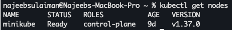
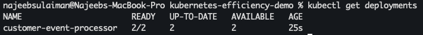
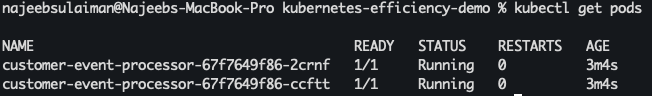
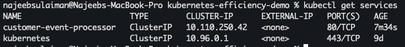
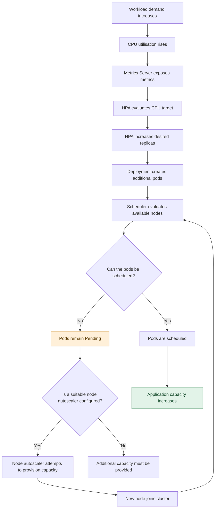
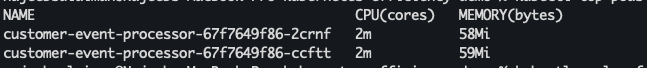
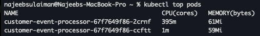
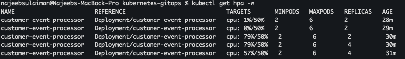
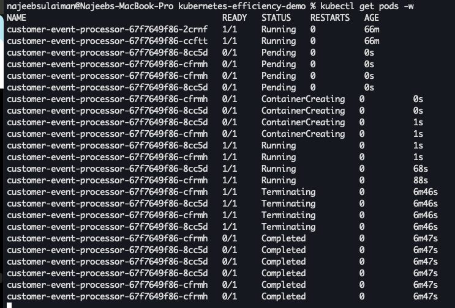

# Kubernetes Efficiency: Beyond Rightsizing

Explore how Kubernetes manages resources, schedules workloads and responds to changing demand through a practical, hands-on demonstration.

This repository contains a small CPU-intensive application deployed to Kubernetes. The application is used it to experiment with resource requests and limits, observe the Horizontal Pod Autoscaler (HPA), investigate why pods remain Pending even when nodes appear to have unused CPU, and understand the relationship between application scaling and infrastructure capacity.

## Why this project?

Consider a service that processes customer events throughout the day. During quiet periods, it consumes relatively little CPU. When demand increases, it needs more processing capacity.

How should we provision the infrastructure?

- Should we allocate enough resources to handle peak demand and accept lower utilisation during quiet periods?
- Should we reduce CPU requests so that more pods can fit onto existing nodes?
- Should we rely on autoscaling to respond to changes in demand?
- What happens when HPA creates additional pods but the cluster doesn't have enough capacity to schedule them?
- Does higher resource utilisation necessarily mean more sustainable infrastructure?

These questions expose a very important insight: Kubernetes efficiency is beyond a single configuration setting or utilisation metric.

This project provides practical experiments to explore these questions.

## Technology stack

| Technology | Purpose |
| ---- | ----|
| Python | Application and load generator
| FastAPI | Lightweight HTTP application
| Docker | Containerisation
| Kubernetes |	Workload orchestration
| Minikube | Local Kubernetes environment
| Metrics Server | Container and node resource metrics
| HPA | Application-level autoscaling

## Prerequisites

You will need:

- Docker
- Minikube
- kubectl
- Python (for the load generator, if running locally)
- Familiarity with containers and Kubernetes

This project uses Minikube so you can experiment locally without requiring a managed Kubernetes cluster or cloud account.

## Getting started

1. Clone the repository

```bash
git clone https://github.com/Najeeb-Sulaiman/kubernetes-efficiency-demo.git

cd kubernetes-efficiency-demo
```

2. Start Minikube

```bash
minikube start --driver=docker
```

Check that your Kubernetes node is ready:

```bash
kubectl get nodes
```

You should see something similar to:



3. Build the application image

```bash
docker build -t customer-event-processor:v1 .
```

Load the image into Minikube:

```bash
minikube image load customer-event-processor:v1
```

4. Deploy the application

Apply the Kubernetes manifests:

```bash
kubectl apply -f k8s/deployment.yaml

kubectl apply -f k8s/service.yaml
```

Check the Deployment and pods:

```bash
kubectl get deployments

kubectl get pods
```

The application should start with two replicas.





Check the Service:

```bash
kubectl get services
```



5. Access the application

Forward the Kubernetes Service to your local machine:

```bash
kubectl port-forward service/customer-event-processor 8000:80
```

In another terminal, test the application:

```bash
curl http://localhost:8000/
```

Check the health endpoint:

```bash
curl http://localhost:8000/health
```

Introduce some CPU-intensive work:

```bash
curl "http://localhost:8000/process?duration=2"
```

The response includes information about the application instance and the work performed.

The port-forward is useful for testing an individual access path. For load-generation experiments, use the Kubernetes Service from inside the cluster so requests can be distributed across its backing pods.

## Scaling Lifecycle

The below diagram visually explains the scaling lifecycle we want to experiment.



## Experiments

So far, we have deployed two replicas with fixed resource allocations. Regardless of whether the application receives 10 requests or 10,000 requests, Kubernetes will maintain those two replicas.

With the following experiments, we will introduce the Horizontal Pod Autoscaler (HPA) and observe how Kubernetes responds when workload demand changes. The aim of this experiments is to understand how the different Kubernetes mechanisms interact and how to effieciently run workloads in Kubernetes.

### Experiment 1: Understand resource requests and limits

Let's start by inspecting the Deployment manifest:

`k8s/deployment.yaml`

The application containers have the following initial resource configuration:

```yaml
resources:
  requests:
    cpu: "250m"
    memory: "128Mi"
  limits:
    cpu: "500m"
    memory: "256Mi"
```

Before changing anything, consider asking these questions:

1. What does a CPU request of 250m actually mean?
2. Does it guarantee that the container always receives 250m of CPU?
3. What happens if the application tries to consume more CPU than its limit?
4. What happens if the container exceeds its memory limit?
5. How might reducing the CPU request affect the number of pods that can be scheduled?

**Experiment:** Change the CPU request and observe how the scheduler's resource accounting changes.

Useful commands:

```bash
kubectl describe node

kubectl top nodes

kubectl top pods
```

Pay attention to the difference between resource capacity, allocatable resources, requested resources and actual consumption.

### Experiment 2: Observe Horizontal Pod Autoscaling

Enable Metrics Server:

```bash
minikube addons enable metrics-server
```

Wait for it to become ready:

```bash
kubectl get deployment metrics-server -n kube-system
```

Now try:

```bash
kubectl top pods
```



You should see CPU and memory consumption.

Deploy the HPA configuration:

```bash
kubectl apply -f k8s/hpa.yaml
```

Inspect the autoscaler:

```bash
kubectl get hpa

kubectl describe hpa customer-event-processor
```


The example HPA configuration uses:

- Minimum replicas: 2
- Maximum replicas: 6
- Target CPU utilisation: 50%

Remember that HPA's CPU utilisation target is calculated relative to the CPU requests.

For example, with a CPU request of `250m` and a target utilisation of `50%`, the target average CPU consumption is approximately `125m` per pod.

Now, introduce concurrent requests using the load generator:

```bash
python load.py
```

The load generator should send concurrent requests to the Kubernetes Service and maintain sufficient workload pressure that will push CPU utilisation above our HPA target and trigger scaling.

Observe the autoscaler:

```bash
kubectl get hpa -w
```

In another terminal:

```bash
kubectl get pods -w
```

And periodically:

```bash
kubectl top pods
```

Don't worry if scaling is not instantaneous. HPA operates through a periodic control loop, and new pods need time to start.

**You should observe:**

- How does CPU utilisation change when load is introduced?
- When does HPA increase the desired replica count?
- How long does it take for new pods to become Ready?
- What happens when the load is removed?
- Does the replica count immediately return to its minimum?

Don't just watch the replica count. Try to understand why it changes and what influences the timing.

Observe scale-down:

Once the 90-second load test finishes, continue watching:

```bash
kubectl get hpa -w
```

You should eventually see the replica count reduce towards the minimum of two.

Scale-down is not may not be immediate. Kubernetes uses stabilisation behaviour to avoid constantly adding and removing replicas when workload fluctuates.

**Example terminal outputs:**

See the rise in CPU consumption when traffic increases:



HPA detects average CPU utilisation exceeds the 50% target, and increases desired replicas



This is the pod autoscaling lifecycle (notice the creation of new pods due to increase in traffic and the termination of pods due to decrease in traffic):




### Experiment 3: Why is my pod Pending when the node has unused CPU?

This experiment demonstrates one of the most important concepts in Kubernetes resource management.

A node can have relatively low actual CPU consumption while having very little unallocated CPU capacity from the scheduler's perspective.

Consider this simplified example:

| Metric | CPU |
| ---- | ----|
| Node allocatable CPU | 2000m |
| Existing pod requests | 1800m
| Actual CPU consumption | 700m
| New pod request | 500m

Although actual CPU consumption is only 700m, the scheduler accounts for 1800m of existing requests.

Adding another pod requesting 500m would require:

```bash
1800m + 500m = 2300m
```

The node only has 2000m of allocatable CPU.

Consequently, the scheduler cannot place the new pod on that node based on CPU capacity.

**Experiment:** Introduce a resource-reservation pod to consume most of the node's remaining schedulable CPU capacity.

Inspect the node's resource accounting:

```bash
kubectl describe node minikube
```

Use the Allocated resources section to understand the existing requests.

Then apply the capacity-reservation manifest:

**Important:** Adjust its CPU request based on the actual available scheduling capacity of your node. Don't assume a fixed value will work across different Minikube configurations.

```bash
kubectl apply -f k8s/capacity-reservation.yaml
```

Reintroduce workload pressure and observe the pods:

```bash
kubectl get pods -w
```

Inspect any Pending pod:

```bash
kubectl describe pod <pending-pod-name>
```

Look for scheduling events such as:

```bash
FailedScheduling
Insufficient cpu
```

The key takeaway here is that Actual CPU consumption and schedulable CPU capacity are not the same thing.

### Experiment 4: What happens when we introduce another node?

We have seen how HPA can request additional replicas while the scheduler cannot find enough capacity to place them.

What changes when another node becomes available?

Add a Minikube node:

```bash
minikube node add
```

Check the cluster:

```bash
kubectl get nodes
```

Make sure the application image is available to the new node. Depending on your Minikube version, you can use:

```bash
minikube image load customer-event-processor:v1 --all
```

Then observe pod placement:

```bash
kubectl get pods -o wide -w
```

If the additional node has sufficient allocatable resources and satisfies the pod's scheduling requirements, previously Pending pods can now be scheduled.

**Important distinction:** This experiment manually adds a Minikube node. It demonstrates the effect of additional node capacity, not automatic node autoscaling.

In a production environment, a configured node autoscaler can automate infrastructure scaling when eligible pods cannot be scheduled.

## Cleaning up

Remove the Kubernetes resources:

```bash
kubectl delete -f k8s/
```

If you created the reservation pod or other resources outside the manifests, remove those separately.

Stop Minikube:

```bash
minikube stop
```

Or delete the local cluster entirely:

```bash
minikube delete --all
```

## Further reading

Deepen your understanding by connecting the experiments with the official Kubernetes documentation.

- [Resource Management for Pods and Containers](https://kubernetes.io/docs/concepts/configuration/manage-resources-containers/)
- [Kubernetes Scheduler](https://kubernetes.io/docs/concepts/scheduling-eviction/kube-scheduler/)
- [Assigning Pods to Nodes](https://kubernetes.io/docs/concepts/scheduling-eviction/assign-pod-node/)
- Horizontal Pod Autoscaling
- Node Autoscaling
- Metrics Server